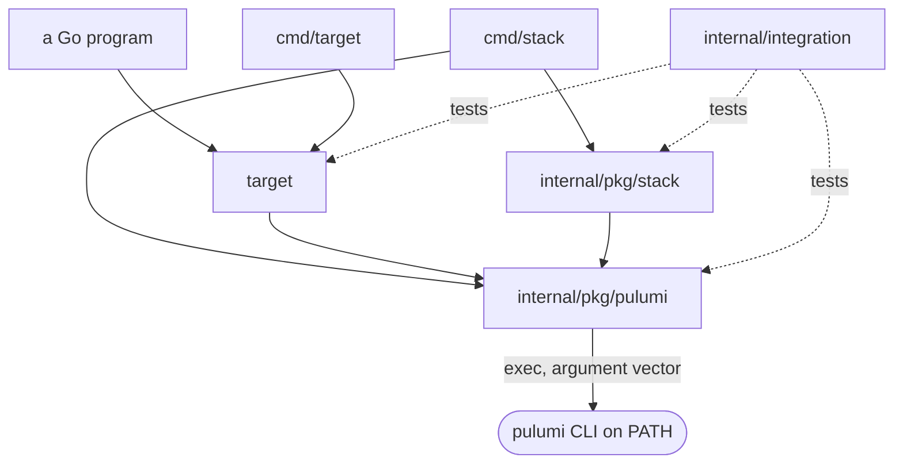
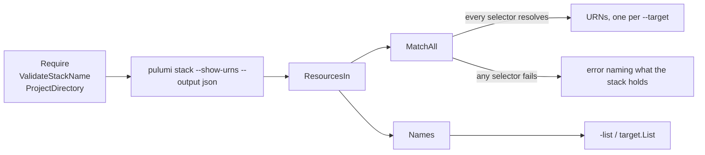

# Design

## What each package owns

| Package | Owns |
|---------|------|
| [`internal/pkg/pulumi`](../internal/pkg/pulumi) | running the CLI, and the three checks both commands make before it runs: the CLI is installed, the stack name, the project directory |
| [`internal/pkg/stack`](../internal/pkg/stack) | whether a stack exists, making sure it does, and its fully qualified reference |
| [`target`](../target) | turning a selector into URNs, or refusing with the list of what the stack holds. The one public package |
| [`cmd/*`](../cmd) | argument parsing and printing. No decisions |
| [`internal/integration`](../internal/integration) | the packages above against a real CLI, behind the `integration` build tag |
| [`internal/ci`](../internal/ci) | the workflow's path filter, release condition and Renovate pins, held to tables |



Only `target` is importable from outside the module; everything under
`internal/` is not.

## One public package

`target` is importable, so a Go program that drives Pulumi resolves selectors
in-process instead of running the command and reading its output. `Resolve`
and `List` make the checks the command makes, in the same order, and
`cmd/target` is a thin wrapper over them: a Go caller and a shell caller are
refused the same inputs with the same words.

The rest stays internal. The runner and the stack checks are how `target`
works, not something a caller should depend on, and `stack` answers questions
a shell asks — a Go program has the Automation API for those. What `target`
does has no equivalent there.

## One runner, not one per command

Both commands started with their own way of invoking the CLI — one setting
`cmd.Dir`, the other passing `--cwd` — and they disagreed about more than that.
Only one validated the stack name it handed to `exec`, and only one said
anything useful when the directory held no `Pulumi.yaml`. Neither difference
was a decision; both were accidents of having been written separately.

`internal/pkg/pulumi` is the one place all three now live, and `Run` sets the
working directory rather than passing `--cwd`. The asymmetry that unifying them
exposed became its own fix: both commands now make all three checks. The
directory one matters more than it looks: handed a directory without
`Pulumi.yaml`, the CLI searches upwards and answers for whichever project
encloses it, so `stack exists` in a subdirectory once reported the parent's
stack.

## Parsing is separated from calling

Every function that reads the CLI's output is separate from the one that runs
it. That is what lets the decisions be tested against output written by hand,
with no Pulumi backend and no network — which is most of what the test suite
does.



Only the second box calls the CLI. Everything after it is tested against JSON
written by hand.

Output written by hand cannot notice the CLI changing shape, so
[`internal/integration`](../internal/integration) runs the same packages
against a real CLI, behind the `integration` build tag. Its stack is imported
from a state a real program produced, into a file backend in a temporary
directory, so it needs neither an account nor a language SDK nor the network.

## The group package is required, not guessed

A component named `Ingress` has the type token `<pkg>:platform:Ingress`. A
Kubernetes Ingress has `kubernetes:networking.k8s.io/v1:Ingress`. The same
type **leaf**.

Matching on the leaf alone made `group:Ingress` take every Ingress object in
the cluster, so `target` needs the package a component's token begins with and
refuses a `group:` selector without it. Targeting more than was asked for is
the one failure a tool about targeting must not have.

## Why these two tools exist at all

Both are wrappers around a silence.

**`--target` that matches nothing succeeds.** Measured:

```
pulumi preview --target '**::Release::does-not-exist'
Resources:
    + 1 to create
    24 unchanged
```

Exit code zero. A caller that passes a mistyped name reports success and
applies nothing. Pulumi has since started refusing an exact URN that is not in
the stack, but a pattern like this one, and an `--exclude` given one, are
still silent — measured on v3.267.0 and still so on v3.270.0, and held by a
canary in `internal/integration` so a CLI bump says when that changes.

**`stack init || stack select` reports the wrong failure.** The `||` form
discards init's stderr to keep the "already exists" case quiet, so a rejected
stack tag, a bad token or no network all surface as select complaining the
stack does not exist. That cost a real diagnosis once: init was refusing a
description over 256 characters, and the operator read `no stack named 'dev'
found`.
